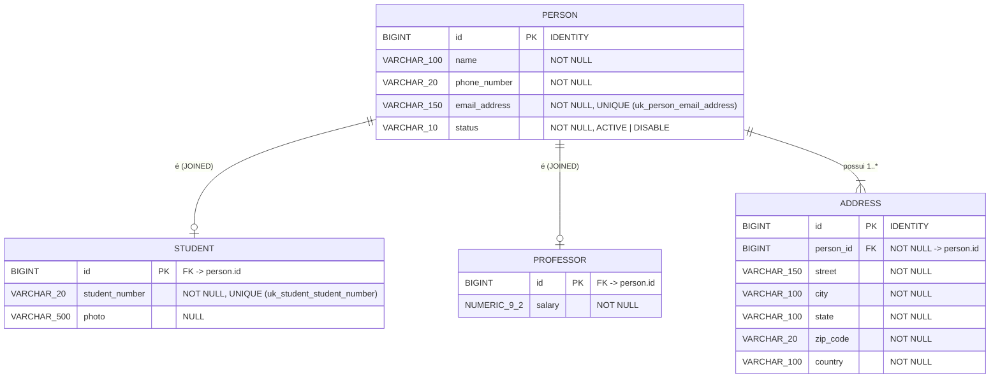
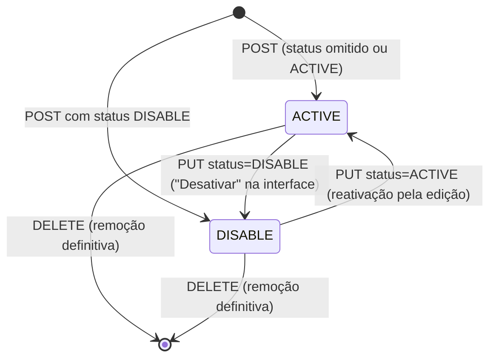

# Data Model — Gestão de Alunos e Professores

**Feature**: `002-students-professors-crud` | **Date**: 2026-10-19 | **Plan**: [plan.md](plan.md)

Fonte da verdade: `docs/modelagem-bomjesus.png` (Princípio VII). Pacote base:
`br.com.bomjesus.academic`.

## Diagrama físico (JPA `JOINED`)



## Entidades (`model`)

### `Status` (enum)

| Valor | Significado |
|-------|-------------|
| `ACTIVE` | pessoa ativa na instituição (padrão na criação) |
| `DISABLE` | pessoa desativada; continua consultável e editável |

Persistido como texto (`@Enumerated(EnumType.STRING)`, Princípio VII).

### `Person` (abstrata)

`@Entity @Table(name = "person") @Inheritance(strategy = InheritanceType.JOINED)`, classe
`abstract`.

| Campo | Tipo Java | Coluna | Restrições de banco |
|-------|-----------|--------|---------------------|
| `id` | `Long` | `id` | PK, `@GeneratedValue(strategy = IDENTITY)` |
| `name` | `String` | `name` | `NOT NULL`, `length = 100` |
| `phoneNumber` | `String` | `phone_number` | `NOT NULL`, `length = 20` |
| `emailAddress` | `String` | `email_address` | `NOT NULL`, `length = 150`, `UNIQUE` |
| `status` | `Status` | `status` | `NOT NULL`, `length = 10`, `EnumType.STRING` |
| `addresses` | `List<Address>` | — | `@OneToMany(mappedBy = "person", cascade = ALL, orphanRemoval = true)`, `@OrderBy("id ASC")` |

Comportamento de domínio:

- `replaceAddresses(Collection<Address> newAddresses)`: chama `addresses.clear()` e, para cada
  item, `address.setPerson(this)` e `addresses.add(address)`. A referência da lista nunca é
  trocada.
- Sem `equals`/`hashCode` sobrescritos, para evitar problemas com proxies e entidades
  transitórias. Sem Lombok.

### `Student` extends `Person`

`@Entity @Table(name = "student")` (PK compartilhada com `person.id`).

| Campo | Tipo Java | Coluna | Restrições de banco |
|-------|-----------|--------|---------------------|
| `studentNumber` | `String` | `student_number` | `NOT NULL`, `length = 20`, `UNIQUE` |
| `photo` | `String` | `photo` | `NULL`, `length = 500` |

### `Professor` extends `Person`

`@Entity @Table(name = "professor")`.

| Campo | Tipo Java | Coluna | Restrições de banco |
|-------|-----------|--------|---------------------|
| `salary` | `BigDecimal` | `salary` | `NOT NULL`, `precision = 9`, `scale = 2` |

### `Address`

`@Entity @Table(name = "address")`.

| Campo | Tipo Java | Coluna | Restrições de banco |
|-------|-----------|--------|---------------------|
| `id` | `Long` | `id` | PK, `IDENTITY` (interno, não exposto na API) |
| `person` | `Person` | `person_id` | `@ManyToOne(fetch = LAZY, optional = false)`, FK `NOT NULL` |
| `street` | `String` | `street` | `NOT NULL`, `length = 150` |
| `city` | `String` | `city` | `NOT NULL`, `length = 100` |
| `state` | `String` | `state` | `NOT NULL`, `length = 100` |
| `zipCode` | `String` | `zip_code` | `NOT NULL`, `length = 20` |
| `country` | `String` | `country` | `NOT NULL`, `length = 100` |

## DTOs (`dto`) e regras de validação

Todos os DTOs são `record`s. Antes da validação, o corpo JSON passa pelo deserializador global,
que aplica `trim` e converte texto vazio em `null` (research R10). As mensagens ficam em
`ValidationMessages.properties`, em pt-BR.

### `AddressRequest` → `AddressResponse`

| Campo | Validação (entrada) |
|-------|---------------------|
| `street` | `@NotBlank`, `@Size(max = 150)` |
| `city` | `@NotBlank`, `@Size(max = 100)` |
| `state` | `@NotBlank`, `@Size(min = 2, max = 100)` |
| `zipCode` | `@NotBlank`, `@Pattern("^[A-Za-z0-9 -]{3,20}$")` |
| `country` | `@NotBlank`, `@Size(min = 2, max = 100)` |

`AddressResponse` tem os mesmos 5 campos, sem `id`.

### Campos comuns de pessoa (presentes em `StudentRequest` e `ProfessorRequest`)

| Campo | Validação (entrada) |
|-------|---------------------|
| `name` | `@NotBlank`, `@Size(min = 3, max = 100)` |
| `phoneNumber` | `@NotBlank`, `@Pattern("^(?=(?:\\D*\\d){8,15}\\D*$)\\+?[0-9 ()-]+$")`, `@Size(max = 20)` |
| `emailAddress` | `@NotBlank`, `@Email(regexp = ".+@.+\\..+")`, `@Size(max = 150)` |
| `status` | opcional (`Status`); valor fora do enum vira 400 via deserialização |
| `addresses` | `@NotEmpty`, `@Valid List<AddressRequest>` |

### `StudentRequest` / `StudentResponse`

| Campo | Validação (entrada) |
|-------|---------------------|
| `studentNumber` | `@NotBlank`, `@Pattern("^[A-Za-z0-9-]{1,20}$")` |
| `photo` | opcional; `@Size(max = 500)`, `@Pattern("^https?://\\S+$")` |

`StudentResponse`: `id`, `name`, `phoneNumber`, `emailAddress`, `status`, `studentNumber`,
`photo`, `addresses` (`List<AddressResponse>`). Sem foto, `photo` sai como `null` (nunca é
omitido).

### `ProfessorRequest` / `ProfessorResponse`

| Campo | Validação (entrada) |
|-------|---------------------|
| `salary` | `@NotNull`, `@DecimalMin("0.01")`, `@DecimalMax("1000000.00")`, `@Digits(integer = 7, fraction = 2)` |

`ProfessorResponse`: `id`, `name`, `phoneNumber`, `emailAddress`, `status`, `salary`,
`addresses`.

## Regras de negócio (Service)

| ID | Regra | Onde | Resultado | Spec |
|----|-------|------|-----------|------|
| BR-01 | `emailAddress` gravado em minúsculas | `StudentService`/`ProfessorService`, antes de checar unicidade | — | FR-003 |
| BR-02 | `studentNumber` gravado em maiúsculas | `StudentService`, antes de checar unicidade | — | FR-009 |
| BR-03 | `salary` com escala 2 (`setScale(2, RoundingMode.UNNECESSARY)`) | `ProfessorService` | resposta sempre com 2 casas | FR-012 |
| BR-04 | E-mail único entre todas as pessoas | `EmailUniquenessGuard` (`PersonRepository.existsByEmailAddress[AndIdNot]`) | `ConflictException("emailAddress", ...)` → 409 | FR-003 |
| BR-05 | Matrícula única entre alunos | `StudentRepository.existsByStudentNumber[AndIdNot]` | `ConflictException("studentNumber", ...)` → 409 | FR-009 |
| BR-06 | `status` ausente na criação | `StudentMapper`/`ProfessorMapper` (`defaultValue = "ACTIVE"`) | `ACTIVE` | FR-002 |
| BR-07 | `status` ausente na atualização | mapper de atualização (`IGNORE` em nulos para `status`) | mantém o status atual | FR-006 |
| BR-08 | Ordenação das listagens | Service, em memória: `Collator` pt-BR (força `PRIMARY`) + desempate por `id` | ignora maiúsculas e acentos | FR-005 |
| BR-09 | Endereços na criação e atualização | `person.replaceAddresses(...)` | substituição completa, na ordem enviada; órfãos apagados; repetidos aceitos | FR-004 |
| BR-10 | Exclusão | `repository.delete(entity)` após `findById` | pessoa e endereços removidos (cascata); 404 se não existir | FR-007 |
| BR-11 | Recurso do tipo errado (`/api/professors/{idDeAluno}`) | `ProfessorRepository.findById` só enxerga professores | 404 | Edge Cases |

**Ordem obrigatória em `create`/`update`**: (1) normalizar a partir do request (BR-01/BR-02) →
(2) checar unicidade (BR-04/BR-05) → (3) só então alterar a entidade e chamar `replaceAddresses`.
Alterar a entidade gerenciada antes do passo (2) dispara o auto-flush do Hibernate e gera um 409
sem campo (research R7).

## Transições de estado



## Repositórios (`repository`)

| Repositório | Métodos além do `JpaRepository` |
|-------------|----------------------------------|
| `PersonRepository extends JpaRepository<Person, Long>` | `existsByEmailAddress(String)`, `existsByEmailAddressAndIdNot(String, Long)` |
| `StudentRepository extends JpaRepository<Student, Long>` | `findAllWithAddresses()` e `findAllWithAddressesByStatus(Status)` (JPQL sem `ORDER BY` + `@EntityGraph("addresses")`; a ordenação é a BR-08, no Service); `findWithAddressesById(Long)` (`@EntityGraph`); `existsByStudentNumber(String)`; `existsByStudentNumberAndIdNot(String, Long)` |
| `ProfessorRepository extends JpaRepository<Professor, Long>` | `findAllWithAddresses()`, `findAllWithAddressesByStatus(Status)`, `findWithAddressesById(Long)` |

## Mapeamento DTO ↔ Entidade (MapStruct, pacote `mapper`)

| Mapper | Métodos | Notas |
|--------|---------|-------|
| `CentralMapperConfig` (`@MapperConfig`) | — | `componentModel = SPRING`, `injectionStrategy = CONSTRUCTOR`, `unmappedTargetPolicy = ERROR` |
| `AddressMapper` | `Address toEntity(AddressRequest)`, `List<Address> toEntities(List<AddressRequest>)`, `AddressResponse toResponse(Address)` | ignora `id` e `person` (ligados por `replaceAddresses`) |
| `StudentMapper(uses = AddressMapper)` | `Student toEntity(StudentRequest)`, `void updateEntity(StudentRequest, @MappingTarget Student)`, `StudentResponse toResponse(Student)` | `toEntity`/`updateEntity` ignoram `id` e `addresses`; `status` com `defaultValue = "ACTIVE"` em `toEntity` e `IGNORE` para nulo em `updateEntity` |
| `ProfessorMapper(uses = AddressMapper)` | idem para `Professor` | — |

## Formato de erro (`exception`)

`ProblemDetail` (RFC 9457), definido em [contracts/openapi.yaml](contracts/openapi.yaml)
(`ProblemDetail`, `FieldError`):

```json
{
  "type": "about:blank",
  "title": "Dados inválidos",
  "status": 400,
  "detail": "A requisição possui 2 campo(s) inválido(s).",
  "instance": "/api/students",
  "timestamp": "2026-10-19T14:30:00Z",
  "errors": [
    { "field": "emailAddress", "message": "deve ser um e-mail válido" },
    { "field": "addresses[0].city", "message": "é obrigatório" }
  ]
}
```
